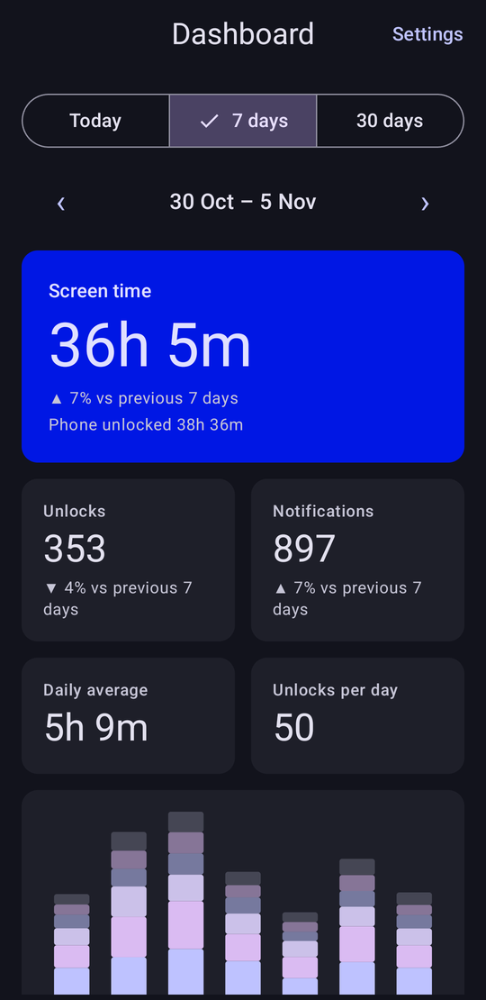
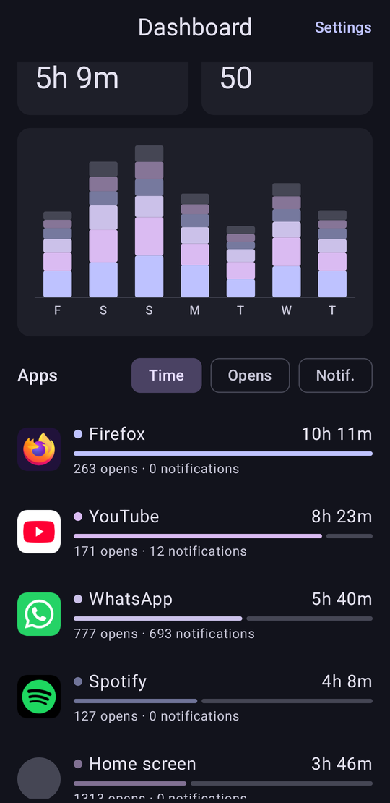
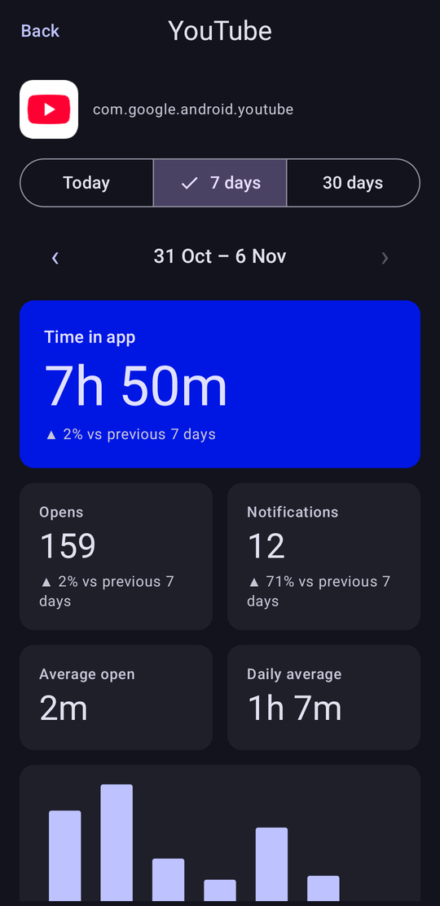
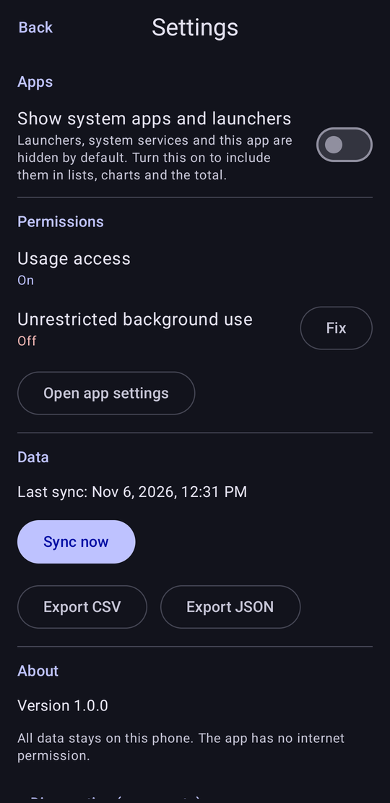

# Screen Time

A small, private Android app that measures how long you use your phone and each app. A minimal replacement for
Digital Wellbeing's dashboard: no account, no ads, no analytics, and no internet permission at all. Everything
stays on the device.

> **Requires Android 9 (API 28) or newer.**

## Screenshots

<p align="center">
  
  
  
  
</p>

*The screenshots show made-up demo data, not a real person's usage.*

## What it shows

- **Screen time** per day, 7 days or 30 days, with the change against the previous period.
- **Phone unlocked** time, **unlocks**, **notifications** per app, **first pickup** and **last use** of the day.
- Hourly (Today) or daily stacked bars coloured by your top apps.
- Per-app list (time, opens, notifications) and a detail screen with "when you use it" by hour.
- Export of your data as CSV or JSON from Settings. English and Italian, light and dark, Material 3 dynamic colour.

Numbers were validated against Google's Digital Wellbeing on a real device: the total stays within about 4 %
of it and per-app times match to the minute for most apps (see [docs/ARCHITECTURE.md](docs/ARCHITECTURE.md)).

## How it works, in short

Android already keeps a log of app usage, screen and lock events for about 10 days. Screen Time asks for
*Usage access*, copies that log into its own database every few hours (and whenever you open it) and keeps it
forever. There is no always-running service and no notification, so it uses almost no battery and keeps working
after a reboot or in battery-saver mode.

## Install

1. Download the APK (`screentime-<version>.apk`) from the Releases page, or build it yourself (below).
2. Allow "Install unknown apps" for the app you opened the file with, then install.
3. Open Screen Time and follow the short setup: grant **Usage access** and, optionally, exempt the app from battery
   optimization (the app shows brand-specific tips for Xiaomi, Samsung, realme/Oppo/OnePlus and others).

**Updating:** install a newer APK signed with the same key over the old one; data is kept.
**If you force-stop the app** (Settings → Apps → Force stop, or an aggressive "cleaner"), Android cancels its
background sync until you open it again. Open it at least once every few days: Android only keeps about 10 days of
detail, so nothing is lost as long as that is respected.

## Permissions

| Permission | Why |
|---|---|
| Usage access (`PACKAGE_USAGE_STATS`) | Read the system usage log. Granted by you in system settings. |
| `QUERY_ALL_PACKAGES` | Show names and icons of the apps you use. |
| `REQUEST_IGNORE_BATTERY_OPTIMIZATIONS` | Optional: lets you exempt the app from battery optimization. |

No `INTERNET` permission, no accounts, no analytics, no crash reporting.

## Limitations

- **Android only**, and only the main user profile (no work profile). An iOS version is not planned: iOS does not
  let an app read usage numbers.
- History starts at install time plus whatever Android still has (about 10 days).
- Not distributed on Google Play (`QUERY_ALL_PACKAGES` is restricted there).
- Time with no recorded foreground activity (for example a video in a floating window) is not credited to any app;
  it only appears in "Phone unlocked".

## Build

Requirements: JDK 17 or newer (Android Studio's bundled JDK works), the Android SDK with platform 36, and an
Android device or emulator with Android 9+ for running.

```bash
# Debug build and unit tests
./gradlew assembleDebug testDebugUnitTest

# Install on a connected device
./gradlew installDebug
```

If `java` on your path is older than 17, point Gradle at a newer JDK, e.g. on Windows with Android Studio:
`JAVA_HOME="C:\Program Files\Android\Android Studio\jbr"`. Create `local.properties` with `sdk.dir=<path to your SDK>`
if Android Studio has not done so.

**Release build.** Without signing configuration `./gradlew assembleRelease` produces an *unsigned* APK. To sign it,
create your own key and a `keystore.properties` file in the project root (both are git-ignored):

```properties
storeFile=/absolute/path/to/your-release.jks
storePassword=...
keyAlias=...
keyPassword=...
```

Keep the key backed up: without it, installed copies cannot be updated in place.

**Granting Usage access on a development device** (instead of tapping through Settings):
`adb shell appops set io.github.romanfabio.screentime GET_USAGE_STATS allow`

## Project layout

See [docs/ARCHITECTURE.md](docs/ARCHITECTURE.md) for the design, the event-interpretation rules and the data model,
and [CLAUDE.md](CLAUDE.md) for contributor notes. Tech stack: Kotlin, Jetpack Compose (Material 3), Room,
WorkManager; one Gradle module; minSdk 28, targetSdk and compileSdk 36.

## Contributing

Issues and pull requests are welcome. Please keep the app minimal, offline (no new network permissions), and
private. Add or update unit tests with any change to `domain/`; changes to how events are interpreted should also be
checked against a real device.

## License

[MIT](LICENSE). Third-party libraries and their licenses are listed in
[THIRD_PARTY_NOTICES.md](THIRD_PARTY_NOTICES.md). "Android", "Google" and "Digital Wellbeing" are trademarks of
Google LLC; this project is not affiliated with Google.
